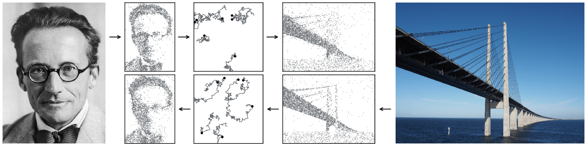

# Reflected Schrödinger Bridge Matching


<sub>Photo of the Öresund Bridge: [Hajotthu](https://commons.wikimedia.org/wiki/File:%C3%96resundbr%C3%BCcke_nach_Kopenhagen.JPG), [CC BY-SA 4.0](https://creativecommons.org/licenses/by-sa/4.0/), adapted. This figure is licensed under CC BY-SA 4.0. Schrödinger portrait: public domain. See [data/figs/README.md](data/figs/README.md).</sub>

If you use this code, please cite the associated paper: <https://arxiv.org/abs/2607.03626>

The trained weights and training records of the paper's runs are on Zenodo:
<https://doi.org/10.5281/zenodo.24574007> (see [REPRODUCE.md](REPRODUCE.md)).


## How to run
**To reproduce the results of the paper, please see [REPRODUCE.md](REPRODUCE.md)**

Choose experiment (required):
```bash
python train.py experiment=afhq64
```

The presets in `conf/experiment/` are:
- `afhq64`: AFHQ cat ↔ wild, 64×64
- `mnist_to_emnist`: MNIST ↔ EMNIST
- `uniform_to_checkerboard`: uniform → checkerboard
- `schrodinger_to_oresund`: Schrödinger ↔ Öresund Bridge
- `rsb_fbsde_uniform_to_checkerboard`, `rsb_fbsde_schrodinger_to_oresund`: the same two problems with the RSB-FBSDE baseline (Deng et al., 2024)

To distribute on `N` GPUs with accelerate:
```bash
accelerate launch --num_processes N train.py experiment=...
```

For reflected Brownian bridge, add
```bash
... sde=reflected
```

Debug mode (output under `outputs/debug/`):
```bash
... debug=on
```

Resume a checkpoint with the run's original settings; it continues in the
checkpoint's run directory, keeping the first launch's `.hydra/` and `git.json`
and recording itself under `.hydra/resumes/<n>/`:
```bash
... training.resume.dir=outputs/path/to/checkpoints/c_{final, 1000, etc.}
```
Resuming an older checkpoint moves what the run recorded after it (evaluations,
curve and diagnostic rows, checkpoints, the final export) to
`{eval,checkpoints}/abandoned/<n>/`. The active records then match an
uninterrupted run.

By default, full eval is run when training completes. To run eval again, possibly with other configurations, there is `eval.py`:
```bash
python eval.py path/to/final_model_ema.safetensors [eval.n_samples=1024 sde.euler_steps=200 ...] [--out DIR] [--device cpu]
```


## Seed
Set the run seed with
```bash
python train.py ... seed=0
```

## Data
Instructions for retrieving AFHQv2 data are at <https://github.com/clovaai/stargan-v2/blob/master/README.md#animal-faces-hq-dataset-afhq>.
Place under `data/` as follows.
```text
data/
└── AFHQ/
    ├── test/
    │   ├── cat/
    │   ├── dog/
    │   └── wild/
    └── train/
        ├── cat/
        ├── dog/
        └── wild/
```
`MNIST` and `EMNIST` should automatically download to the proper place.


## Apptainer
The paper's runs used an Apptainer image built from `my-pytorch.def`, which
pins the NGC PyTorch base image and the packages it adds. Build it in the
repository root, where the scripts in `slurm/` expect it:
```bash
apptainer build my-pytorch.sif my-pytorch.def
```

The image presets use `torch.compile`: AFHQ and MNIST ↔ EMNIST compile the EMA
model to speed up sampling during finetuning (`training.compile_ema`), and AFHQ
also compiles the trained network for its training updates
(`training.compile_model`). Inside the image, Triton must be told the directory
that holds `libcuda.so.1`, as the image experiments' Slurm scripts do:
```bash
apptainer exec --nv --env TRITON_LIBCUDA_PATH=/usr/local/cuda/compat/lib.real my-pytorch.sif python train.py experiment=afhq64
```
Use that directory in your image if it differs, or train without compiling by
setting both options to `false`.
